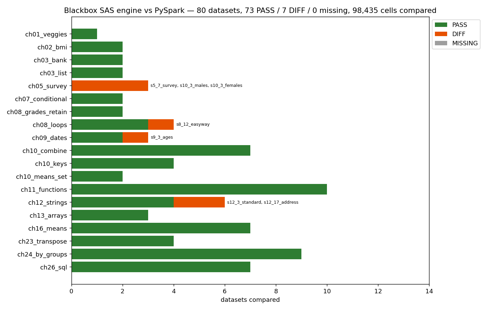

# SAS (blackbox engine) vs PySpark parity report

Generated by `parity/run_parity.sh` on 2026-11-25 15:45 UTC. Every number below is computed from the SAS-engine and PySpark outputs of that run (`parity/build/parity_results.json`).

## Summary

| Metric | Value |
|---|---|
| Cases (SAS programs run in one session each) | 19 |
| SAS book programs / setup blocks covered | 82 |
| Datasets compared | 80 |
| **PASS** (schema + row count + every value) | **73** |
| DIFF | 7 |
| Missing on one side | 0 |
| SAS output rows compared | 17708 |
| Cells compared | 98435 |
| SAS log ERROR lines | 0 |
| SAS log `NOTE: Invalid data` lines (expected: deliberately malformed mock fields) | 30 |
| PySpark job failures | 0 |
| DIFF classified ENGINE_GAP | 7 |

Tolerance: numeric |a-b| <= 1e-9 + 1e-9*max(|a|,|b|); character values compared after removing trailing blanks; SAS missing == Spark NULL.

## Per case

| Case | What it exercises | SAS steps | Datasets | PASS | DIFF | SAS rows | SAS run (s) | PySpark (s) |
|---|---|---|---|---|---|---|---|---|
| `ch01_veggies` | List input, $8 default length, division by zero | 1-1 | 1 | 1 | 0 | 400 | 0.6 | 3.6 |
| `ch02_bmi` | List input + BMI expression with missing values | 2-2, 3-2 | 2 | 2 | 0 | 1000 | 0.7 | 1.3 |
| `ch03_bank` | Column input and formatted input (mmddyy10., 7.) | 3-6, 3-7 | 2 | 2 | 0 | 1200 | 0.9 | 1.3 |
| `ch03_list` | DSD / & modifier list input with informats | 3-10, 3-12 | 2 | 2 | 0 | 800 | 0.7 | 1.4 |
| `ch05_survey` | PAD infile, grouped informats, user formats on a permanent dataset | 5-6, 5-7, 10-3 | 3 | 0 | 3 | 1000 | 0.6 | 1.2 |
| `ch07_conditional` | IF/ELSE-IF chains and SELECT/WHEN over missing values | 7-3, 7-5 | 2 | 2 | 0 | 600 | 0.6 | 1.0 |
| `ch08_grades_retain` | MISSOVER, DO groups, RETAIN and sum statements | 8-2, 8-5 | 2 | 2 | 0 | 717 | 0.6 | 0.8 |
| `ch08_loops` | Iterative DO, DO UNTIL, CONTINUE with explicit OUTPUT | 8-9, 8-13, 8-19, 8-12 | 4 | 3 | 1 | 40 | 0.6 | 1.3 |
| `ch09_dates` | Date informats, YEARCUTOFF, YRDIF, WEEKDAY/DAY/MONTH/YEAR | 9-2, 9-3, 9-6 | 3 | 2 | 1 | 1200 | 1.1 | 1.6 |
| `ch10_combine` | SET concatenation, interleave, MERGE with IN=, multi-OUTPUT | ch10-setup, 10-4, 10-5, 10-6, 10-8, 10-10, 10-11 | 7 | 7 | 0 | 520 | 0.8 | 6.3 |
| `ch10_keys` | RENAME= merge, PUT(ssn11.), INPUT/COMPRESS, UPDATE | ch10-setup, 10-13, 10-14, 10-15, 10-16 | 4 | 4 | 0 | 229 | 0.6 | 4.1 |
| `ch10_means_set` | PROC MEANS autoname + IF _N_=1 THEN SET | BLOOD, 10-7 | 2 | 2 | 0 | 1501 | 0.8 | 0.8 |
| `ch11_functions` | Numeric functions, LAG/DIF, LARGEST, CALL SORTN, missing counters | BLOOD, 11-3, 11-1, 11-4, 11-5, 11-7, 11-15, 11-16, 11-18, 11-19, 11-20 | 10 | 10 | 0 | 3170 | 1.0 | 4.6 |
| `ch12_strings` | PROPCASE/COMPBL, SUBSTR, SCAN, TRANSLATE, TRANWRD, #n pointers | ADDRESS, 12-3, 12-12, 12-13, 12-14, 12-16, 12-17 | 6 | 4 | 2 | 610 | 0.7 | 2.4 |
| `ch13_arrays` | Arrays, non-1 lower bounds, _TEMPORARY_ answer keys, @@ | 13-5, 13-6, 13-7 | 3 | 3 | 0 | 380 | 0.9 | 1.6 |
| `ch16_means` | PROC MEANS OUTPUT: stats, NWAY, CHARTYPE _TYPE_, split by _TYPE_ | BLOOD, 16-7, 16-11, 16-13, 16-15 | 7 | 7 | 0 | 21 | 0.7 | 4.4 |
| `ch23_transpose` | Wide<->long with arrays, FIRST./LAST., PROC TRANSPOSE | ONEPER, 23-1, 23-2, 23-3, 23-5 | 4 | 4 | 0 | 1957 | 0.6 | 2.4 |
| `ch24_by_groups` | BY-group processing, PROC FREQ OUT=, conditional LAG | CLINIC, 24-1, 24-2, 24-3, 24-4, 24-5, 24-6, 24-7, 24-8 | 9 | 9 | 0 | 1456 | 0.8 | 5.3 |
| `ch26_sql` | PROC SQL: WHERE, inner/left/right/full joins, remerged summary | HEALTH, DEMOGRAPHIC, 26-3, 26-7, 26-8, 26-9, 26-11 | 7 | 7 | 0 | 907 | 0.7 | 3.1 |

## Per dataset

| Case | Step | Dataset | Status | Rows SAS / PySpark | Cols | Cells | Note |
|---|---|---|---|---|---|---|---|
| `ch01_veggies` | book:1-1 | Veg | PASS | 400 / 400 | 6 | 2400 |  |
| `ch02_bmi` | book:2-2 | Demographic | PASS | 500 / 500 | 5 | 2500 |  |
| `ch02_bmi` | book:3-2 | Demographics | PASS | 500 / 500 | 4 | 2000 |  |
| `ch03_bank` | book:3-6 | Financial | PASS | 600 / 600 | 4 | 2400 |  |
| `ch03_bank` | book:3-7 | Financial | PASS | 600 / 600 | 4 | 2400 |  |
| `ch03_list` | book:3-10 | List_Example | PASS | 400 / 400 | 4 | 1600 |  |
| `ch03_list` | book:3-12 | list_example | PASS | 400 / 400 | 4 | 1600 |  |
| `ch05_survey` | book:5-7 | Learn.Survey | DIFF | 500 / 500 | 9 | 2000 | ENGINE_GAP |
| `ch05_survey` | book:10-3 | Males | DIFF | 247 / 247 | 9 | 988 | ENGINE_GAP |
| `ch05_survey` | book:10-3 | Females | DIFF | 253 / 253 | 9 | 1012 | ENGINE_GAP |
| `ch07_conditional` | book:7-3 | Conditional | PASS | 300 / 300 | 6 | 1800 |  |
| `ch07_conditional` | book:7-5 | Conditional | PASS | 300 / 300 | 6 | 1800 |  |
| `ch08_grades_retain` | book:8-2 | Grades | PASS | 467 / 467 | 7 | 3269 |  |
| `ch08_grades_retain` | book:8-5 | Revenue | PASS | 250 / 250 | 3 | 750 |  |
| `ch08_loops` | book:8-9 | Compound | PASS | 3 / 3 | 3 | 9 |  |
| `ch08_loops` | book:8-13 | Double | PASS | 19 / 19 | 3 | 57 |  |
| `ch08_loops` | book:8-19 | Continue_on | PASS | 8 / 8 | 3 | 24 |  |
| `ch08_loops` | book:8-12 | Easyway | DIFF | 10 / 10 | 3 | 20 | ENGINE_GAP |
| `ch09_dates` | book:9-2 | Four_Dates | PASS | 400 / 400 | 5 | 2000 |  |
| `ch09_dates` | book:9-3 | Ages | DIFF | 400 / 400 | 6 | 2400 | ENGINE_GAP |
| `ch09_dates` | book:9-6 | Extract | PASS | 400 / 400 | 9 | 3600 |  |
| `ch10_combine` | book:10-4 | One_Two | PASS | 100 / 100 | 3 | 300 |  |
| `ch10_combine` | book:10-5 | One_Three | PASS | 80 / 80 | 4 | 320 |  |
| `ch10_combine` | book:10-6 | Interleave | PASS | 100 / 100 | 3 | 300 |  |
| `ch10_combine` | book:10-8 | Combine | PASS | 105 / 105 | 4 | 420 |  |
| `ch10_combine` | book:10-10 | Combine | PASS | 60 / 60 | 4 | 240 |  |
| `ch10_combine` | book:10-11 | In_Both | PASS | 60 / 60 | 4 | 240 |  |
| `ch10_combine` | book:10-11 | Missing_Name | PASS | 15 / 15 | 3 | 45 |  |
| `ch10_keys` | book:10-13 | Sesame | PASS | 74 / 74 | 3 | 222 |  |
| `ch10_keys` | book:10-14 | Both_Divisions | PASS | 60 / 60 | 5 | 300 |  |
| `ch10_keys` | book:10-15 | Division2N | PASS | 50 / 50 | 3 | 150 |  |
| `ch10_keys` | book:10-16 | Prices_15dec2017 | PASS | 45 / 45 | 3 | 135 |  |
| `ch10_means_set` | book:10-7 | Means | PASS | 1 / 1 | 1 | 1 |  |
| `ch10_means_set` | book:10-7 | Percent | PASS | 1500 / 1500 | 4 | 6000 |  |
| `ch11_functions` | book:11-3 | Test_Miss | PASS | 1500 / 1500 | 10 | 15000 |  |
| `ch11_functions` | book:11-1 | Truncate | PASS | 200 / 200 | 5 | 1000 |  |
| `ch11_functions` | book:11-4 | Psych | PASS | 200 / 200 | 14 | 2800 |  |
| `ch11_functions` | book:11-5 | Three_Large | PASS | 200 / 200 | 12 | 2400 |  |
| `ch11_functions` | book:11-7 | Math | PASS | 120 / 120 | 5 | 600 |  |
| `ch11_functions` | book:11-15 | Look_Back | PASS | 200 / 200 | 4 | 800 |  |
| `ch11_functions` | book:11-16 | Laggard | PASS | 150 / 150 | 2 | 300 |  |
| `ch11_functions` | book:11-18 | Diff | PASS | 200 / 200 | 3 | 600 |  |
| `ch11_functions` | book:11-19 | Quizzes | PASS | 200 / 200 | 10 | 2000 |  |
| `ch11_functions` | book:11-20 | Quizzes | PASS | 200 / 200 | 10 | 2000 |  |
| `ch12_strings` | book:12-3 | Standard | DIFF | 60 / 60 | 5 | 300 | ENGINE_GAP |
| `ch12_strings` | book:12-12 | Extract | PASS | 150 / 150 | 5 | 750 |  |
| `ch12_strings` | book:12-13 | First_Last | PASS | 120 / 120 | 3 | 360 |  |
| `ch12_strings` | book:12-14 | Last | PASS | 120 / 120 | 2 | 240 |  |
| `ch12_strings` | book:12-16 | Trans | PASS | 100 / 100 | 1 | 100 |  |
| `ch12_strings` | book:12-17 | Address | DIFF | 60 / 60 | 5 | 300 | ENGINE_GAP |
| `ch13_arrays` | book:13-5 | Temp | PASS | 30 / 30 | 48 | 1440 |  |
| `ch13_arrays` | book:13-6 | Account | PASS | 150 / 150 | 18 | 2700 |  |
| `ch13_arrays` | book:13-7 | Score | PASS | 200 / 200 | 3 | 600 |  |
| `ch16_means` | book:16-7 | Many_Stats | PASS | 1 / 1 | 10 | 10 |  |
| `ch16_means` | book:16-11 | With_Class | PASS | 2 / 2 | 7 | 14 |  |
| `ch16_means` | book:16-13 | Summary | PASS | 9 / 9 | 8 | 72 |  |
| `ch16_means` | book:16-15 | Grand | PASS | 1 / 1 | 5 | 5 |  |
| `ch16_means` | book:16-15 | By_gender | PASS | 2 / 2 | 6 | 12 |  |
| `ch16_means` | book:16-15 | By_Age | PASS | 2 / 2 | 6 | 12 |  |
| `ch16_means` | book:16-15 | Cellmeans | PASS | 4 / 4 | 7 | 28 |  |
| `ch23_transpose` | book:23-1 | Learn.ManyPer | PASS | 587 / 587 | 3 | 1761 |  |
| `ch23_transpose` | book:23-2 | OnePer | PASS | 235 / 235 | 4 | 940 |  |
| `ch23_transpose` | book:23-3 | ManyPer | PASS | 900 / 900 | 3 | 2700 |  |
| `ch23_transpose` | book:23-5 | OnePer | PASS | 235 / 235 | 4 | 940 |  |
| `ch24_by_groups` | book:24-1 | Last | PASS | 120 / 120 | 6 | 720 |  |
| `ch24_by_groups` | book:24-2 | Count | PASS | 120 / 120 | 7 | 840 |  |
| `ch24_by_groups` | book:24-3 | Counts | PASS | 120 / 120 | 3 | 360 |  |
| `ch24_by_groups` | book:24-4 | Counts | PASS | 120 / 120 | 2 | 240 |  |
| `ch24_by_groups` | book:24-4 | Clinic | PASS | 404 / 404 | 7 | 2828 |  |
| `ch24_by_groups` | book:24-5 | Difference | PASS | 284 / 284 | 10 | 2840 |  |
| `ch24_by_groups` | book:24-6 | First_Last | PASS | 84 / 84 | 10 | 840 |  |
| `ch24_by_groups` | book:24-7 | First_Last | PASS | 84 / 84 | 10 | 840 |  |
| `ch24_by_groups` | book:24-8 | Hypertension | PASS | 120 / 120 | 7 | 840 |  |
| `ch26_sql` | book:26-3 | Height65 | PASS | 81 / 81 | 3 | 243 |  |
| `ch26_sql` | book:26-7 | Inner | PASS | 76 / 76 | 6 | 456 |  |
| `ch26_sql` | book:26-8 | _sql1 | PASS | 76 / 76 | 6 | 456 |  (unordered) |
| `ch26_sql` | book:26-9 | _sql1 | PASS | 150 / 150 | 4 | 600 |  (unordered) |
| `ch26_sql` | book:26-9 | _sql2 | PASS | 150 / 150 | 4 | 600 |  (unordered) |
| `ch26_sql` | book:26-9 | _sql3 | PASS | 224 / 224 | 4 | 896 |  (unordered) |
| `ch26_sql` | book:26-11 | _sql1 | PASS | 150 / 150 | 5 | 750 |  |

## Translation bugs found and fixed

Found by earlier runs of this harness; the numbers above are from the run after the fixes.

- **s10_8_combine, s10_11_missing_name, s10_13_sesame, s10_14_both_divisions** — `match_merge` lost every non-BY value (all NULL) because the self-joined frames had ambiguous column lineage; rewritten with uniquely renamed columns per input dataset.
- **s10_14_both_divisions** — MERGE output put the BY variable first; SAS's PDV order is first appearance across the input datasets (DOB Gender SS JobCode Salary). Ports now keep that order.
- **s24_3_counts** — The port applied 24-4's `(rename=(count=N_Visits) drop=percent)` to 24-3's `out=Counts`; 24-3 keeps COUNT and PERCENT. Split into s24_3_counts and s24_4_counts.
- **ch09_dates (job failure)** — DATE9. informat used `array_position(array, column)`, which PySpark 3.5 rejects (`Column is not iterable`); replaced with a month map lookup.
- **ch12_strings (job failure)** — PROPCASE was a Python UDF whose module was not importable on the Spark workers; replaced with a native higher-order-function expression.

## Differences

### `s5_7_survey` (ch05_survey, book:5-7) — ENGINE_GAP

`input ... (Ques1-Ques5)(: $1.);` — the engine ignores the `$` in a grouped informat list and creates Ques1-Ques5 as numeric (values 1-5) instead of character $1. SAS reads them as character (that is why the program attaches the character format `$Likert.`). PySpark keeps them character.

- type differs: Ques1 SAS=num PySpark=char, Ques2 SAS=num PySpark=char, Ques3 SAS=num PySpark=char, Ques4 SAS=num PySpark=char, Ques5 SAS=num PySpark=char

### `s10_3_males` (ch05_survey, book:10-3) — ENGINE_GAP

`input ... (Ques1-Ques5)(: $1.);` — the engine ignores the `$` in a grouped informat list and creates Ques1-Ques5 as numeric (values 1-5) instead of character $1. SAS reads them as character (that is why the program attaches the character format `$Likert.`). PySpark keeps them character.

- type differs: Ques1 SAS=num PySpark=char, Ques2 SAS=num PySpark=char, Ques3 SAS=num PySpark=char, Ques4 SAS=num PySpark=char, Ques5 SAS=num PySpark=char

### `s10_3_females` (ch05_survey, book:10-3) — ENGINE_GAP

`input ... (Ques1-Ques5)(: $1.);` — the engine ignores the `$` in a grouped informat list and creates Ques1-Ques5 as numeric (values 1-5) instead of character $1. SAS reads them as character (that is why the program attaches the character format `$Likert.`). PySpark keeps them character.

- type differs: Ques1 SAS=num PySpark=char, Ques2 SAS=num PySpark=char, Ques3 SAS=num PySpark=char, Ques4 SAS=num PySpark=char, Ques5 SAS=num PySpark=char

### `s8_12_easyway` (ch08_loops, book:8-12) — ENGINE_GAP

`do Group = 'Placebo','Active';` — the engine creates Group as a numeric variable and every value is missing; SAS creates a character variable (length 7) holding 'Placebo' for Subj 1-5 and 'Active' for Subj 6-10. All other columns match.

- type differs: Group SAS=num PySpark=char

### `s9_3_ages` (ch09_dates, book:9-3) — ENGINE_GAP

`Age = yrdif(DOB, VisitDate);` — with no basis argument the engine uses the 'AGE' basis (`_yrdif(ctx, a, b, basis="AGE")` in sasengine/functions.py); the SAS 9.4 documentation gives 'ACT/ACT' as the default basis, which the PySpark port implements. Differences are at most 0.0026 year and only occur where the interval spans a leap day / partial years.

- 176 row(s) with value differences in Age
  - `Age`: 176 value(s) differ, e.g. row 2: SAS=80.10958904 PySpark=80.10949921; row 4: SAS=62.03561644 PySpark=62.03562392; row 5: SAS=40.38356164 PySpark=40.38299274

### `s12_3_standard` (ch12_strings, book:12-3) — ENGINE_GAP

`propcase(Name)` — the engine also upper-cases the letter after an apostrophe (O'Brien); SAS's default PROPCASE delimiters are blank / - ( . and tab, so SAS returns O'brien (the SAS documentation example gives `Ed O'brien`). PySpark follows SAS.

- 12 row(s) with value differences in Name
  - `Name`: 12 value(s) differ, e.g. row 2: SAS="Jason O'Brien-Jones" PySpark="Jason O'brien-Jones"; row 8: SAS="O'Neil O'Brien-Jones" PySpark="O'neil O'brien-Jones"; row 13: SAS="O'Neil Tran" PySpark="O'neil Tran"

### `s12_17_address` (ch12_strings, book:12-17) — ENGINE_GAP

`infile datalines dlm=' ,'; input ... #3 City & $20. State : $2. Zip : $5.;` — with the & modifier SAS keeps single embedded blanks and ends the value at two consecutive delimiters (', '), giving City='Long Beach', State='NJ'. The engine ends City at the first blank ('Long'), shifting State/Zip. Only records whose city has an embedded blank differ.

- 31 row(s) with value differences in City, State, Zip
  - `City`: 31 value(s) differ, e.g. row 1: SAS='Long' PySpark='Long Beach'; row 2: SAS='Long' PySpark='Long Beach'; row 5: SAS='Salt' PySpark='Salt Lake City'
  - `State`: 31 value(s) differ, e.g. row 1: SAS='Be' PySpark='NJ'; row 2: SAS='Be' PySpark='UT'; row 5: SAS='La' PySpark='NJ'
  - `Zip`: 31 value(s) differ, e.g. row 1: SAS='NJ' PySpark='15904'; row 2: SAS='UT' PySpark='59184'; row 5: SAS='City' PySpark='91775'

